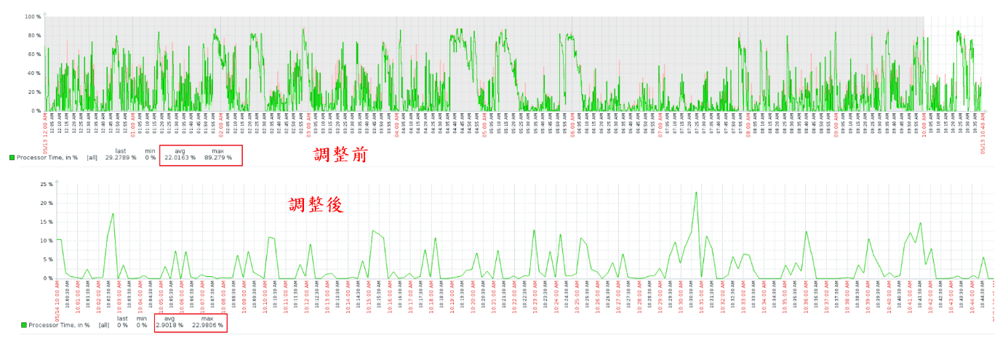

# 專案成就｜SQL Server 資料庫效能調校

## 履歷摘要

- **SQL Server CPU 效能改善**：透過 SQL Execution Plan 與 Session 分析，定位高 CPU 查詢，協同應用程式端調整影響索引使用的 SQL 條件，並調整報表查詢索引及補建必要索引，將資料庫伺服器平均 **CPU 使用率由約 22% 降至 3%**，尖峰 **CPU 使用率由約 90% 降至 23%**，分別降低約 **86%** 與 **74%**。

## 專案背景

透過 Zabbix 監控發現，SQL Server 於特定時段反覆出現 CPU 使用率偏高情形，平均使用率約 22%，尖峰接近 90%。針對異常時段進行查詢與索引分析，改善資料庫運算負載。

## 分析與改善措施

- **定位高負載查詢**：於 CPU 升高時檢查 Session 執行情況，搭配 SQL Execution Plan 分析查詢條件與索引使用情形。
- **調整查詢條件**：SQL Server 所選用的定序（Collation）不區分大小寫，但 AP 仍使用 `WHERE LOWER(column_name) = @column_para` 進行篩選。在此定序下，大小寫轉換並無必要，且對欄位套用 `LOWER()` 導致查詢無法有效使用既有索引，增加 CPU 負載。協同應用程式端改為 `WHERE column_name = @column_para`，保留不區分大小寫的比對行為，並移除影響索引使用的函數運算。
- **調整報表索引**：檢視報表 SQL 與現有索引的適配性，依實際查詢需求調整索引。
- **補建必要索引**：針對缺少適當索引的查詢資料表，依 SQL 存取條件建立索引。
- **驗證調校成效**：比對調整前後的 CPU 監控數據，確認平均與尖峰使用率均明顯下降。

### SQL 條件調整範例

調整前：

```sql
WHERE LOWER(column_name) = @column_para
```

調整後：

```sql
WHERE column_name = @column_para
```

此調整以本案比對欄位使用不區分大小寫的定序為前提。

## 量化成果

| 效能指標 | 調校前 | 調校後 | 改善幅度 |
| --- | ---: | ---: | ---: |
| 平均 CPU 使用率 | 約 22% | 約 3% | 下降 19 個百分點，約降低 86% |
| 尖峰 CPU 使用率 | 約 90% | 約 23% | 下降 67 個百分點，約降低 74% |

> 改善幅度依四捨五入後的 CPU 使用率計算；成果依調校前後監控資料比對。

## 調校前後監控圖

**平均 CPU：約 22% → 3%｜尖峰 CPU：約 90% → 23%**



上圖為調校前，下圖為調校後。圖片擷取自原始監控截圖，保留曲線、時間軸、縱軸刻度與統計數值，並遮蔽主機名稱。

> 判讀說明：調校前縱軸上限為 100%，調校後為 25%，應搭配刻度與統計數值比較。兩圖呈現不同觀測時段的實測結果，並非相同工作負載下的控制測試。

## 使用技術

SQL Server、T-SQL、SQL Execution Plan、Session 分析、索引調校、Zabbix。
