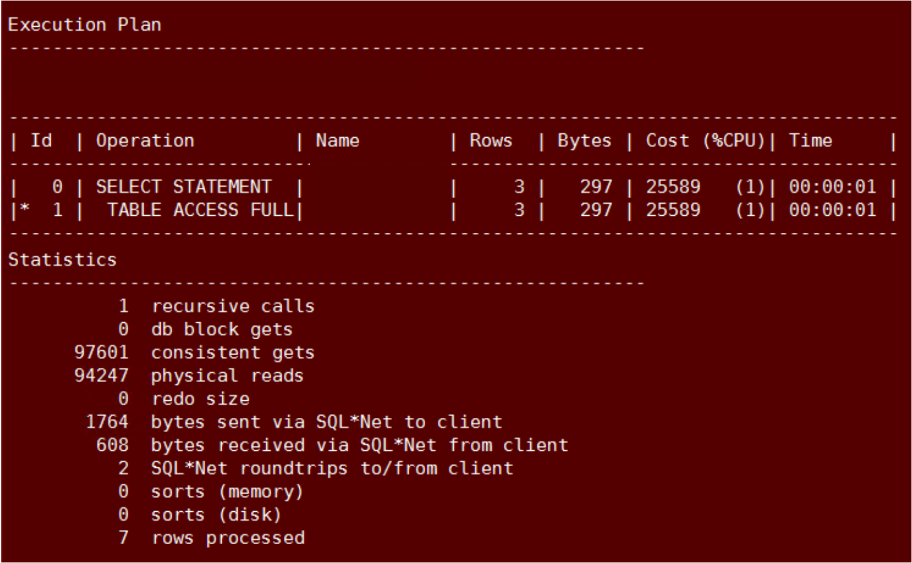

# 專案成就｜Oracle SQL 效能優化

## 履歷摘要

- **Oracle SQL 效能優化**：運用 AWR 與 Autotrace，定位高 I/O、高頻率執行的 SQL，分析既有索引與查詢條件後建立適當索引，於還原的測試環境將執行計畫由 Full Table Scan 改為 Index Range Scan 搭配回表存取，單次 Logical I/O（Consistent Gets）由 **97,601 降至 368，減少約 99.6%**。

## 專案背景與原因

監控發現資料庫於假日較常出現 CPU 使用率偏高的情形。透過 AWR 與 Oracle Enterprise Manager（EM）效能資訊追查，發現一段 SQL 在 15 分鐘內執行 4,609 次，且每次執行均採取全表掃描，累積大量 I/O 負載。

資料表雖已有索引，但既有複合索引的首欄並非此 SQL 的主要篩選欄位，未能有效支援該查詢。隨資料量持續成長，高頻率的全表掃描增加了資料庫的資源消耗。

## 分析與改善措施

- **定位高負載 SQL**：透過 AWR 與 EM 效能資訊，確認問題 SQL 的執行頻率與資源消耗。
- **建立驗證環境**：還原資料庫至測試環境，並分析資料表、更新統計資訊，進行索引調校驗證。
- **確認調校前基準**：使用 `SET AUTOTRACE TRACEONLY`，檢查執行計畫、Consistent Gets 與 Physical Reads，確認原先採用 `TABLE ACCESS FULL`。
- **建立適當索引**：檢視查詢條件與既有索引欄位順序，針對主要等值篩選欄位建立索引。
- **驗證調校成效**：再次執行查詢，確認存取路徑改為 `INDEX RANGE SCAN` 搭配 `TABLE ACCESS BY INDEX ROWID BATCHED`，並比對單次執行的 I/O 統計。

## 量化成果

| 效能指標 | 建立索引前 | 建立索引後 | 改善結果 |
| --- | ---: | ---: | --- |
| Logical I/O（Consistent Gets） | 97,601 | 368 | 減少 97,233，約降低 **99.6%** |
| Physical Reads | 94,247 | 0 | 本次測試執行未產生實體讀取 |
| Optimizer Cost | 25,589 | 11 | 最佳化器估算成本明顯下降 |

| 執行計畫 | 存取方式 |
| --- | --- |
| 建立索引前 | `TABLE ACCESS FULL` |
| 建立索引後 | `INDEX RANGE SCAN` + `TABLE ACCESS BY INDEX ROWID BATCHED` |

> Consistent Gets 改善幅度以 `(97,601 - 368) / 97,601` 計算，約為 99.62%。以上為還原的測試環境中單次 SQL 執行的比對結果。Physical Reads 會受快取狀態影響；Optimizer Cost 為估算成本，不代表實際執行時間或倍數。此紀錄未提供上線後 CPU 降幅或回應時間數據。

## 調校前後執行計畫與統計

### 調校前：Full Table Scan

執行計畫採用 `TABLE ACCESS FULL`；單次 Consistent Gets 為 **97,601**，Physical Reads 為 **94,247**。

### 調校後：Index Range Scan

建立適當索引後，執行計畫改為 `INDEX RANGE SCAN` 搭配 `TABLE ACCESS BY INDEX ROWID BATCHED`；單次 Consistent Gets 降至 **368**，Physical Reads 為 **0**。

> 圖片擷取自原始調校紀錄，將同一次執行的執行計畫與統計區塊上下排版，省略查詢條件並遮蔽內部物件名稱及計畫雜湊值。保留原始存取方式與統計數字，未重繪或變更數據。結果為還原測試環境中的單次執行比較。

## 使用技術

Oracle Database、SQL、AWR、Oracle Enterprise Manager、Autotrace、執行計畫分析、索引設計、統計資訊。

## 資料呈現說明

本頁依既有調校紀錄整理，省略內部系統名稱、Schema、資料表名稱、SQL ID、帳號值及聯絡資訊；原始內部郵件與 PDF 未納入公開儲存庫。
