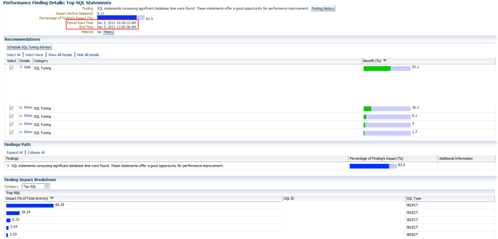
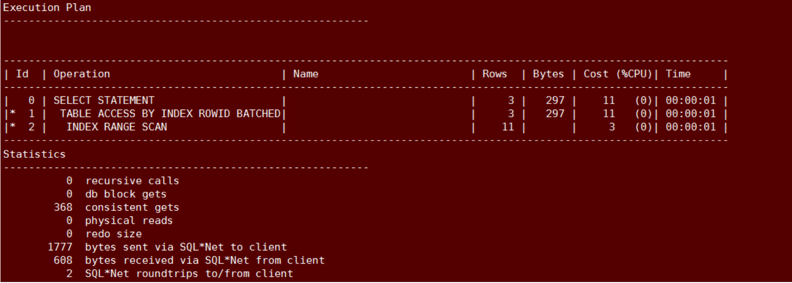

# Oracle 效能改善｜減少高頻率查詢的資料讀取量

透過建立合適的索引，在還原的測試環境中，將單次查詢的**邏輯讀取量由 97,601 降至 368，減少約 99.6%**。

## 當時遇到的問題

監控發現，資料庫在假日較常出現運算負載偏高的情形。我追查後發現，一段查詢在 15 分鐘內執行了 4,609 次，而且每次都要掃描整張資料表才能找出需要的資料。

當查詢頻率高、資料持續增加時，這種查找方式會反覆讀取大量資料，累積可觀的資源消耗。

## 如何找出優先改善的查詢

我使用 Oracle Enterprise Manager（EM，資料庫管理與效能分析工具），查看哪些查詢占用了較多資料庫資源，再選出優先調查的對象。

下圖的藍色橫條呈現各查詢在該次分析中的活動影響占比。排名第一的查詢約占 **68.35%**，因此是優先追查的重點；配合執行紀錄，進一步確認它在約 15 分鐘內執行了 **4,609 次**。

> 此圖用於說明問題定位過程。圖中的活動影響占比及工具預估效益，不代表改善後的實測降幅；本案實測成果仍以後續測試的邏輯讀取量減少約 99.6% 為準。圖片已省略主機、系統、登入資訊、SQL 內容與 SQL 識別碼，保留原始分析圖表及數值。

## 我如何處理

1. **找出重複消耗資源的查詢**：分析效能紀錄，確認問題查詢的執行頻率及資料讀取情況。
2. **檢查查找方式**：確認資料表雖然已有索引，但索引的欄位順序未能有效支援這段查詢。
3. **在測試環境驗證**：還原資料庫、更新統計資訊，記錄建立索引前的查詢方式與讀取量。
4. **建立合適的索引**：針對查詢主要使用的篩選欄位建立索引，讓資料庫能先定位所需資料，再讀取對應內容。
5. **比對改善結果**：確認資料庫不再掃描整張資料表，並以單次查詢的讀取統計驗證改善效果。

## 改善成果

「邏輯讀取量」是資料庫處理查詢時讀取資料區塊的計數，並非資料筆數。這個案例的重點是：完成一次查詢所需的資料讀取工作大幅減少。

| 比較項目 | 改善前 | 改善後 |
| --- | --- | --- |
| 資料查找方式 | 掃描整張資料表 | 先透過索引定位，再讀取對應資料 |
| 單次邏輯讀取量 | 97,601 | **368** |
| 邏輯讀取量減幅 | — | **約 99.6%** |

> 以上是還原測試環境中的單次執行比較，未直接換算為上線後的回應時間或整台伺服器 CPU 改善幅度。

## 前後驗證圖

圖片是資料庫工具記錄的原始結果。可直接看圖中 `consistent gets` 這一列，比較改善前後的邏輯讀取量。

### 改善前：每次查詢都掃描整張資料表

圖中的 `TABLE ACCESS FULL` 代表全表掃描；`consistent gets` 為 **97,601**。

### 改善後：利用索引縮小查找範圍

圖中的 `INDEX RANGE SCAN` 代表利用索引查找；`consistent gets` 降至 **368**。

## 專案價值

此案例呈現我如何找出高頻率查詢造成的重複消耗，設計合適的資料查找方式，並在測試環境中以數據驗證改善方案。對於反覆執行的查詢，降低單次處理成本，有助於減少累積的資料庫負擔。

技術補充：執行計畫與完整數據

| 效能指標 | 建立索引前 | 建立索引後 |
| --- | ---: | ---: |
| Consistent Gets | 97,601 | 368 |
| Physical Reads | 94,247 | 0 |
| Optimizer Cost | 25,589 | 11 |

執行計畫由 `TABLE ACCESS FULL` 改為 `INDEX RANGE SCAN` 搭配 `TABLE ACCESS BY INDEX ROWID BATCHED`。

Consistent Gets 減幅以 `(97,601 - 368) / 97,601` 計算，約為 99.62%。Physical Reads 受快取狀態影響；Optimizer Cost 為最佳化器的估算成本，不代表實際執行時間。

使用工具與方法：Oracle Database、AWR、Oracle Enterprise Manager、Autotrace、執行計畫分析、索引設計、統計資訊。

圖片保留原始執行計畫與統計數字，將同一次執行的兩個區塊上下排版，並省略查詢條件、遮蔽內部物件名稱及計畫雜湊值。原始內部郵件與 PDF 未公開。
