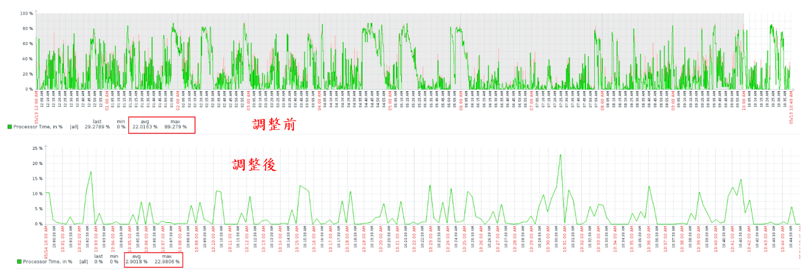

# SQL Server 效能改善｜降低伺服器運算負載

透過調整查詢方式與索引配置，將資料庫伺服器平均 **CPU 使用率由約 22% 降至 3%**，尖峰 **由約 90% 降至 23%**。

## 當時遇到的問題

監控發現，資料庫伺服器在特定時段反覆出現運算負載偏高的情形，尖峰 CPU 使用率接近 90%。我針對異常時段追查正在執行的查詢，找出主要資源消耗來源。

## 我如何處理

1. **找出高負載查詢**：比對監控與查詢執行情況，確認哪些查詢消耗大量運算資源。
2. **移除不必要的運算**：發現應用程式每次查詢時，都先將欄位內容轉成小寫再比對；但資料庫原本就設定為不區分大小寫，因此這個步驟沒有必要，還影響了索引的有效使用。
3. **協同調整查詢方式**：與應用程式端合作，改為直接比對欄位與查詢參數，維持原有的大小寫比對規則，並移除多餘的轉換運算。
4. **改善資料查找目錄**：檢查報表與其他查詢使用的索引，調整不合適的配置，並補上缺少的索引。
5. **確認改善結果**：比對調校前後的監控數據，驗證平均與尖峰 CPU 使用率的變化。

## 改善成果

CPU 使用率可理解為伺服器正在使用多少運算能力。數值下降，代表資料庫消耗的運算資源減少，保留更多餘裕。

| 指標 | 改善前 | 改善後 | 改善幅度 |
| --- | ---: | ---: | --- |
| 平均 CPU 使用率 | 約 22% | 約 3% | 下降 19 個百分點，約降低 **86%** |
| 尖峰 CPU 使用率 | 約 90% | 約 23% | 下降 67 個百分點，約降低 **74%** |

## 前後監控圖

上圖為改善前，下圖為改善後，可搭配圖中平均值與最高值確認成果。



> 兩張圖的縱軸上限不同：上圖為 100%，下圖為 25%，請搭配刻度與數值判讀。數據來自調校前後不同觀測時段，並非相同工作負載下的控制測試；改善比例依表中約數計算。

## 專案價值

此案例呈現我從監控發現問題、追查查詢原因、協同應用程式端改善，再以數據驗證成果的處理能力。改善重點是減少不必要的運算與資料搜尋，降低資料庫負載。

<details>
<summary>技術補充：查詢條件與使用工具</summary>

SQL Server 所選用的定序（Collation）不區分大小寫，但應用程式仍對欄位套用 `LOWER()`，導致查詢無法有效使用既有索引。

調整前：

```sql
WHERE LOWER(column_name) = @column_para
```

調整後：

```sql
WHERE column_name = @column_para
```

此改寫以本案比對欄位使用不區分大小寫的定序為前提。

使用工具與方法：SQL Server、T-SQL、SQL Execution Plan、Session 分析、索引調校、Zabbix。

</details>

圖片已遮蔽主機名稱，保留原始監控曲線與統計數值。
