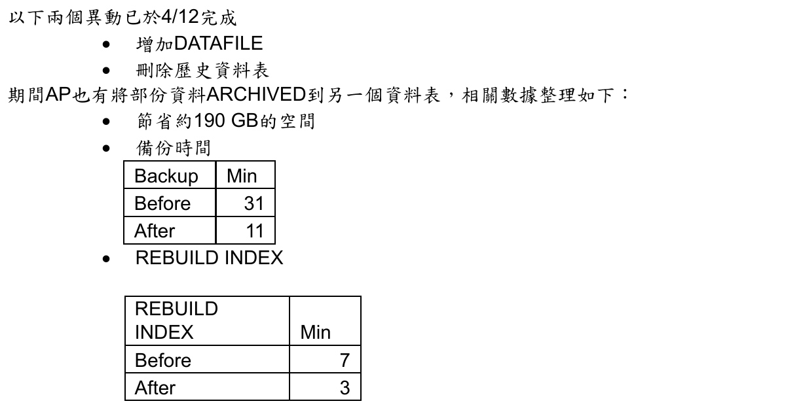

# SQL Server 儲存空間優化｜減少資料占用與維護時間

盤點歷史資料與索引配置，提出清理、索引整併及資料壓縮評估建議，並協同應用程式與專案團隊推進後續改善。後續資料清理、封存與檔案配置調整後，紀錄顯示**節省約 190 GB 空間，備份時間由 31 分鐘縮短至 11 分鐘，索引維護時間由 7 分鐘縮短至 3 分鐘**。

## 當時遇到的問題

資料庫的儲存空間逐漸吃緊，部分空間被歷史資料及體積較大的索引占用。除了持續增加容量，也需要確認哪些資料仍有保留必要、哪些索引可以整併，以及是否有更有效率的儲存方式。

這類調整涉及資料保留需求，必須與應用程式及業務單位確認後再安排執行。

## 我如何處理

1. **盤點空間使用情況**：整理大型資料表、歷史資料及索引的占用情況，找出優先檢查的項目。
2. **確認歷史資料的保留需求**：與應用程式端確認舊資料表是否仍被使用，並協同相關單位討論可清理或封存的範圍。
3. **檢視重複的查找目錄**：比較大型索引的欄位與用途，提出整併或移除冗餘索引的建議。應用程式端回覆，將安排移除其中一個索引。
4. **提出資料壓縮評估方向**：除了清理資料，也建議評估資料壓縮，確認是否能進一步降低占用空間。
5. **協同推進後續調整**：整理資料檔案與索引配置建議，配合團隊安排異動，並彙整完成後的空間、備份及維護數據。

## 改善成果

後續完成資料檔案新增及歷史資料表清理，期間應用程式端也進行了部分資料封存。整體改善紀錄如下：

| 項目 | 改善前 | 改善後 | 成果 |
| --- | ---: | ---: | --- |
| 儲存空間 | — | — | 節省約 **190 GB** |
| 備份時間 | 31 分鐘 | 11 分鐘 | 減少 20 分鐘，約縮短 **65%** |
| 索引維護時間 | 7 分鐘 | 3 分鐘 | 減少 4 分鐘，約縮短 **57%** |

備份是保存資料副本，以便需要時還原；索引維護則是整理資料的查找目錄。這兩項作業時間縮短，代表例行維護所需的時間減少。

> 上述數據是多項調整後的整體結果，包含資料清理、封存與檔案配置調整，無法分別歸因於單一措施。資料壓縮在現有紀錄中屬於評估建議，未列為已完成的改善成果；索引移除則有安排執行的回覆，未另列其實測效益。

## 成果紀錄

下圖擷取自當時的完成回報，保留原始空間與維護時間數據，未包含郵件收件人、聯絡資訊或內部物件名稱。

## 專案價值

此案例呈現我從空間使用現況找出改善機會、與相關單位確認資料需求，再協同推進調整的能力。除了減少資料占用，也透過完成後的紀錄，確認備份與例行維護時間的改善。

技術補充：評估項目與成果範圍

- 歷史資料表的使用情況、占用空間及保留需求盤點。
- 大型索引的欄位與用途比較，以及冗餘索引移除或整併建議。
- Row Compression 與 Page Compression 評估建議；現有紀錄未提供啟用結果或壓縮比。
- Data File 與 Filegroup 配置規劃；完成回報確認資料檔案新增，未將索引搬移單獨列為已完成成果。
- 資料清理與封存後的備份時間、索引重建時間比對。

時間改善比例分別以 `(31 - 11) / 31` 及 `(7 - 3) / 7` 計算，約為 64.5% 與 57.1%。

資料來自不同階段的討論與完成回報；原始內部郵件、PDF 及完整物件清單未公開。

